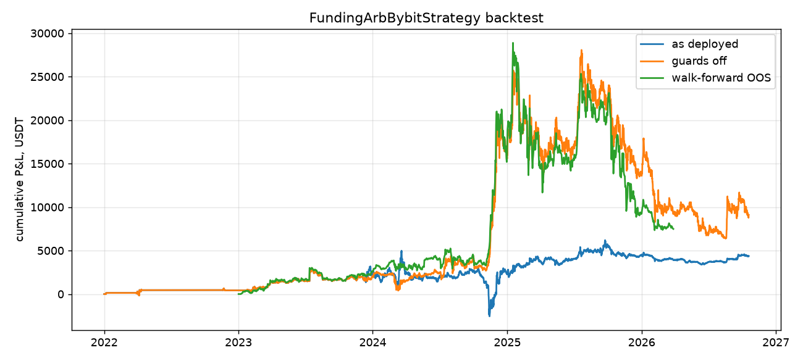

# FundingArbBybitStrategy — whole-system backtest

Trading window: 2022-01-01 00:00 → 2026-10-19 10:00 UTC · symbols: ETHUSDT, LINKUSDT, SOLUSDT, XRPUSDT, DOGEUSDT, AVAXUSDT, DOTUSDT, ATOMUSDT  
Strategy params: defaults · wallet $60,000 · fees perp 5.5 bps / spot 10.0 bps · slippage 2.0 bps/order · guards: in-process $500, consolidator $1,000

**Data notes**

- ETHUSDT: repo `BybitLinearConnector.fetch_funding_rates` returned 200 settlements for the period, the backward pager returned 5288.
- LINKUSDT: repo `BybitLinearConnector.fetch_funding_rates` returned 200 settlements for the period, the backward pager returned 5288.
- SOLUSDT: repo `BybitLinearConnector.fetch_funding_rates` returned 200 settlements for the period, the backward pager returned 5648.
- XRPUSDT: repo `BybitLinearConnector.fetch_funding_rates` returned 200 settlements for the period, the backward pager returned 5288.
- DOGEUSDT: repo `BybitLinearConnector.fetch_funding_rates` returned 200 settlements for the period, the backward pager returned 5288.
- AVAXUSDT: repo `BybitLinearConnector.fetch_funding_rates` returned 200 settlements for the period, the backward pager returned 5288.
- DOTUSDT: repo `BybitLinearConnector.fetch_funding_rates` returned 200 settlements for the period, the backward pager returned 5288.
- ATOMUSDT: repo `BybitLinearConnector.fetch_funding_rates` returned 200 settlements for the period, the backward pager returned 5288.

## Results

### As deployed (both guards active)

| net_pnl | ann_ret_on_cap_% | ann_ret_on_deployed_% | sharpe | max_dd | trades | win_rate_% | avg_trade_bps | avg_hold_periods | funding | fees | price_basis | avg_deployed | max_deployed | naked_hours | rejected_orders |
|---|---|---|---|---|---|---|---|---|---|---|---|---|---|---|---|
| 4,373.60 | 1.52 | 8.53 | 0.33 | -7,547.83 | 24 | 70.83 | 246.49 | 50.58 | 315.86 | 38.86 | 786.84 | 10,685.22 | 32,059.44 | 110708 | 30 |

Orders filled: 77, rejected: 30, phantom fills (consolidator confirmed a fill without sending an order): 0  
In-process guard (re-activates when PnL recovers): **6× (first 2024-11-11 05:00), halted 338 h in total** · consolidator guard (container stopped for good): **2023-12-12 00:00** · symbol-hours with unhedged exposure > $100: **110708**

Rejected orders (exchange, symbol, reason → count):

| exchange | symbol | reason | count |
|---|---|---|---|
| bybit_spot | XRPUSDT | Order quantity has too many decimals (basePrecision 0.01) | 7 |
| bybit_spot | DOGEUSDT | Order quantity has too many decimals (basePrecision 0.1) | 6 |
| bybit_spot | ATOMUSDT | Order quantity has too many decimals (basePrecision 0.01) | 6 |
| bybit_spot | DOGEUSDT | Insufficient balance (coin) | 5 |
| bybit_spot | ATOMUSDT | Insufficient balance (coin) | 5 |
| bybit_spot | XRPUSDT | Insufficient balance (coin) | 1 |

Strategy / consolidator warnings:

| warning | count | first |
|---|---|---|
| ENTRY skipped: notional | 28 | 2023-11-01 08:00  [FundingArbBybit:ETHUSDT] ENTRY skipped: notional 1800.00 / mark 1805.04 rounds to 0 contracts |
| DOGEUSDT buy | 6 | 2022-01-04 00:00  order FAILED [bybit_spot] DOGEUSDT buy qty=10585.585585585586: Order quantity has too many decimals (basePrecision 0.1) — rolling back local position tracking |
| ATOMUSDT buy | 6 | 2022-04-01 00:00  order FAILED [bybit_spot] ATOMUSDT buy qty=62.06206206206206: Order quantity has too many decimals (basePrecision 0.01) — rolling back local position tracking |
| DOGEUSDT sell | 5 | 2022-01-06 16:00  order FAILED [bybit_spot] DOGEUSDT sell qty=10575.0: Insufficient balance (coin) — rolling back local position tracking |
| ATOMUSDT sell | 5 | 2022-04-07 08:00  order FAILED [bybit_spot] ATOMUSDT sell qty=62.0: Insufficient balance (coin) — rolling back local position tracking |
| XRPUSDT buy | 4 | 2022-03-29 00:00  order FAILED [bybit_spot] XRPUSDT buy qty=2084.084084084084: Order quantity has too many decimals (basePrecision 0.01) — rolling back local position tracking |
| XRPUSDT sell | 4 | 2022-04-07 08:00  order FAILED [bybit_spot] XRPUSDT sell qty=2082.0: Insufficient balance (coin) — rolling back local position tracking |
| funding interval | 2 | 2022-11-10 08:00  [FundingArbBybit:SOLUSDT] funding interval 8h -> 2h |
| guard TRIPPED for | 1 | 2023-12-12 00:00  guard TRIPPED for strategy_id='FundingArbBybitStrategy' — halting further signals |
| dropping signal for | 1 | 2023-12-12 00:00  dropping signal for halted strategy_id='FundingArbBybitStrategy': AVAXUSDT qty=-140.14014014014015 |

Largest unhedged-exposure incidents:

| symbol | start | end | hours | max_notional | perp_qty | coin |
|---|---|---|---|---|---|---|
| DOGEUSDT | 2023-12-03 08:00 | 2026-10-19 10:00 | 25227 | 9,998.96 | -21050 | 0 |
| AVAXUSDT | 2023-12-12 00:00 | 2026-10-19 10:00 | 25019 | 8,933.38 | 0 | 139.99975700 |
| XRPUSDT | 2023-02-26 00:00 | 2026-10-19 10:00 | 31955 | 4,994.33 | 0 | 4265.99973000 |
| ATOMUSDT | 2023-12-08 00:00 | 2026-10-19 10:00 | 25115 | 2,574.42 | -181 | 0 |
| DOGEUSDT | 2023-10-26 00:00 | 2023-11-28 07:00 | 800 | 2,297.64 | -26331 | 0 |
| DOGEUSDT | 2022-03-29 00:00 | 2022-04-12 15:00 | 352 | 2,182.63 | -12639 | 0 |
| ATOMUSDT | 2022-04-01 00:00 | 2022-04-07 07:00 | 152 | 2,046.63 | -62 | 0 |
| DOGEUSDT | 2023-01-23 16:00 | 2023-02-15 07:00 | 544 | 2,016.74 | -20400 | 0 |
| ATOMUSDT | 2023-11-12 16:00 | 2023-11-22 07:00 | 232 | 1,993.47 | -191 | 0 |
| DOGEUSDT | 2023-04-14 08:00 | 2023-04-21 23:00 | 184 | 1,898.03 | -20102 | 0 |

Positions still open at the end:

| symbol | perp_qty | coin | strategy_state |
|---|---|---|---|
| LINKUSDT | -113 | 112.99930500 | hedged |
| SOLUSDT | -30 | 29.99989000 | hedged |
| XRPUSDT | -2899 | 4265.99973000 | hedged |
| DOGEUSDT | -21050 | 0 | hedged |
| AVAXUSDT | 0 | 139.99975700 | flat |
| DOTUSDT | -288 | 287.99905800 | hedged |
| ATOMUSDT | -181 | 0 | hedged |

Per symbol:

| symbol | pnl | funding | fees | trades |
|---|---|---|---|---|
| ETHUSDT | 0.00 | 0.00 | 0.00 | 0 |
| LINKUSDT | 475.63 | 496.69 | 18.87 | 3 |
| SOLUSDT | 892.70 | 901.55 | 12.09 | 2 |
| XRPUSDT | 3,003.95 | 885.98 | 10.53 | 4 |
| DOGEUSDT | 1,399.29 | 1,094.88 | 10.78 | 5 |
| AVAXUSDT | -3,903.86 | 74.54 | 16.05 | 3 |
| DOTUSDT | 373.69 | 390.55 | 14.54 | 2 |
| ATOMUSDT | 2,134.82 | 238.53 | 10.62 | 5 |

### Same, guards disabled (pure strategy economics)

| net_pnl | ann_ret_on_cap_% | ann_ret_on_deployed_% | sharpe | max_dd | trades | win_rate_% | avg_trade_bps | avg_hold_periods | funding | fees | price_basis | avg_deployed | max_deployed | naked_hours | rejected_orders |
|---|---|---|---|---|---|---|---|---|---|---|---|---|---|---|---|
| 9,103.54 | 3.16 | 21.25 | 0.20 | -21,682.13 | 67 | 71.64 | 1,148.38 | 61.04 | 2,003.87 | 147.75 | 11,978.48 | 8,923.49 | 41,638.46 | 41067 | 57 |

Orders filled: 211, rejected: 57, phantom fills (consolidator confirmed a fill without sending an order): 0  
In-process guard (re-activates when PnL recovers): **no** · consolidator guard (container stopped for good): **no** · symbol-hours with unhedged exposure > $100: **41067**

Rejected orders (exchange, symbol, reason → count):

| exchange | symbol | reason | count |
|---|---|---|---|
| bybit_spot | XRPUSDT | Order quantity has too many decimals (basePrecision 0.01) | 14 |
| bybit_spot | ATOMUSDT | Order quantity has too many decimals (basePrecision 0.01) | 11 |
| bybit_spot | ATOMUSDT | Insufficient balance (coin) | 11 |
| bybit_spot | DOGEUSDT | Order quantity has too many decimals (basePrecision 0.1) | 10 |
| bybit_spot | DOGEUSDT | Insufficient balance (coin) | 10 |
| bybit_spot | XRPUSDT | Insufficient balance (coin) | 1 |

Strategy / consolidator warnings:

| warning | count | first |
|---|---|---|
| ENTRY skipped: notional | 247 | 2023-11-01 08:00  [FundingArbBybit:ETHUSDT] ENTRY skipped: notional 1800.00 / mark 1805.04 rounds to 0 contracts |
| ATOMUSDT buy | 11 | 2022-04-01 00:00  order FAILED [bybit_spot] ATOMUSDT buy qty=62.06206206206206: Order quantity has too many decimals (basePrecision 0.01) — rolling back local position tracking |
| ATOMUSDT sell | 11 | 2022-04-07 08:00  order FAILED [bybit_spot] ATOMUSDT sell qty=62.0: Insufficient balance (coin) — rolling back local position tracking |
| DOGEUSDT buy | 10 | 2022-01-04 00:00  order FAILED [bybit_spot] DOGEUSDT buy qty=10585.585585585586: Order quantity has too many decimals (basePrecision 0.1) — rolling back local position tracking |
| DOGEUSDT sell | 10 | 2022-01-06 16:00  order FAILED [bybit_spot] DOGEUSDT sell qty=10575.0: Insufficient balance (coin) — rolling back local position tracking |
| XRPUSDT sell | 9 | 2022-04-07 08:00  order FAILED [bybit_spot] XRPUSDT sell qty=2082.0: Insufficient balance (coin) — rolling back local position tracking |
| XRPUSDT buy | 6 | 2022-03-29 00:00  order FAILED [bybit_spot] XRPUSDT buy qty=2084.084084084084: Order quantity has too many decimals (basePrecision 0.01) — rolling back local position tracking |
| funding interval | 2 | 2022-11-10 08:00  [FundingArbBybit:SOLUSDT] funding interval 8h -> 2h |

Largest unhedged-exposure incidents:

| symbol | start | end | hours | max_notional | perp_qty | coin |
|---|---|---|---|---|---|---|
| XRPUSDT | 2023-02-26 00:00 | 2026-10-19 10:00 | 31955 | 29,133.18 | 0 | 4265.99973000 |
| DOGEUSDT | 2024-02-13 08:00 | 2024-03-17 15:00 | 800 | 4,423.67 | -21799 | 0 |
| ATOMUSDT | 2024-02-15 00:00 | 2024-03-19 07:00 | 800 | 2,489.08 | -175 | 0 |
| DOGEUSDT | 2023-10-26 00:00 | 2023-11-28 07:00 | 800 | 2,297.64 | -26331 | 0 |
| ATOMUSDT | 2023-12-08 00:00 | 2024-01-10 07:00 | 800 | 2,216.16 | -181 | 0 |
| DOGEUSDT | 2023-12-03 08:00 | 2024-01-05 15:00 | 800 | 2,204.78 | -21050 | 0 |
| DOGEUSDT | 2022-03-29 00:00 | 2022-04-12 15:00 | 352 | 2,182.63 | -12639 | 0 |
| DOGEUSDT | 2024-11-22 16:00 | 2024-12-09 23:00 | 416 | 2,116.64 | -4456 | 0 |
| ATOMUSDT | 2022-04-01 00:00 | 2022-04-07 07:00 | 152 | 2,046.63 | -62 | 0 |
| DOGEUSDT | 2023-01-23 16:00 | 2023-02-15 07:00 | 544 | 2,016.74 | -20400 | 0 |

Positions still open at the end:

| symbol | perp_qty | coin | strategy_state |
|---|---|---|---|
| XRPUSDT | 0 | 8494.04578000 | flat |

Per symbol:

| symbol | pnl | funding | fees | trades |
|---|---|---|---|---|
| ETHUSDT | 0.00 | 0.00 | 0.00 | 0 |
| LINKUSDT | 199.10 | 257.15 | 54.90 | 10 |
| SOLUSDT | 220.16 | 273.72 | 49.15 | 9 |
| XRPUSDT | 7,022.81 | 413.88 | 36.95 | 10 |
| DOGEUSDT | -388.13 | 320.81 | 20.18 | 10 |
| AVAXUSDT | 215.55 | 282.28 | 60.67 | 10 |
| DOTUSDT | 207.29 | 251.80 | 41.48 | 7 |
| ATOMUSDT | 1,653.93 | 204.23 | 20.91 | 11 |

## Parameter grid (192 combinations, guards off, full period — in-sample)

| entry_threshold_annualized | exit_threshold_annualized | min_consecutive_positive | max_volatility | min_hold_periods | net_pnl | ann_ret_on_cap_% | sharpe | max_dd | trades | avg_trade_bps | naked_hours |
|---|---|---|---|---|---|---|---|---|---|---|---|
| 0.15 | -1.00 | 1 | 0.80 | 1 | 10,154.60 | 3.53 | 0.24 | -19,887.25 | 69 | 928.36 | 41851 |
| 0.15 | 0.00 | 1 | 0.80 | 1 | 10,154.60 | 3.53 | 0.24 | -19,887.25 | 69 | 928.36 | 41851 |
| 0.15 | 0.02 | 1 | 0.80 | 9 | 10,079.40 | 3.50 | 0.24 | -19,860.56 | 68 | 909.29 | 41235 |
| 0.15 | -1.00 | 1 | 0.80 | 9 | 10,054.13 | 3.49 | 0.24 | -19,887.25 | 68 | 933.65 | 41947 |
| 0.15 | 0.00 | 1 | 0.80 | 9 | 10,054.13 | 3.49 | 0.24 | -19,887.25 | 68 | 933.65 | 41947 |
| 0.15 | 0.02 | 1 | 0.80 | 1 | 9,979.39 | 3.46 | 0.24 | -19,860.56 | 69 | 888.04 | 41067 |
| 0.15 | 0.05 | 1 | 0.80 | 9 | 9,954.46 | 3.46 | 0.23 | -19,856.71 | 68 | 899.08 | 41107 |
| 0.15 | 0.05 | 1 | 0.80 | 1 | 9,854.77 | 3.42 | 0.23 | -19,856.38 | 69 | 878.00 | 40939 |
| 0.11 | -1.00 | 1 | 0.80 | 9 | 9,718.03 | 3.37 | 0.17 | -26,559.47 | 70 | 891.89 | 75254 |
| 0.11 | 0.00 | 1 | 0.80 | 9 | 9,718.03 | 3.37 | 0.17 | -26,559.47 | 70 | 891.89 | 75254 |
| 0.11 | 0.02 | 1 | 0.80 | 9 | 9,545.06 | 3.31 | 0.17 | -26,559.92 | 70 | 844.36 | 74630 |
| 0.11 | 0.05 | 1 | 0.80 | 9 | 9,423.92 | 3.27 | 0.16 | -26,556.08 | 70 | 834.27 | 74502 |
| 0.15 | -1.00 | 6 | 0.80 | 1 | 9,418.11 | 3.27 | 0.21 | -21,708.83 | 67 | 1,204.49 | 41723 |
| 0.15 | 0.00 | 6 | 0.80 | 1 | 9,418.11 | 3.27 | 0.21 | -21,708.83 | 67 | 1,204.49 | 41723 |
| 0.11 | -1.00 | 1 | 0.80 | 1 | 9,407.31 | 3.27 | 0.16 | -26,559.47 | 71 | 854.95 | 75206 |

136 of 192 combinations are profitable after costs.

## Walk-forward (optimise on trailing 365 d by `pnl`, trade next 91 d blind)

| series | net_pnl | ann_ret_on_cap_% | sharpe |
|---|---|---|---|
| walk-forward OOS | 7,482.09 | 3.85 | 0.19 |
| best full-sample combo (in-sample) | 9,730.23 | 4.27 | 0.27 |
| current params | 8,679.17 | 3.81 | 0.22 |

| test_start | test_end | oos_pnl | entry_threshold_annualized | exit_threshold_annualized | min_consecutive_positive | max_volatility | min_hold_periods |
|---|---|---|---|---|---|---|---|
| 2023-01-01 08:00 | 2023-04-01 08:00 | 1,424.51 | 0.11 | -1.00 | 1 | 0.80 | 9 |
| 2023-04-02 08:00 | 2023-07-01 08:00 | 283.78 | 0.11 | 0.05 | 3 | 99.00 | 9 |
| 2023-07-02 08:00 | 2023-09-30 08:00 | 80.30 | 0.11 | 0.05 | 6 | 99.00 | 9 |
| 2023-10-01 08:00 | 2023-12-30 08:00 | 790.44 | 0.11 | 0.05 | 6 | 99.00 | 9 |
| 2023-12-31 08:00 | 2024-03-30 08:00 | 498.71 | 0.11 | 0.05 | 6 | 99.00 | 1 |
| 2024-03-31 08:00 | 2024-06-29 08:00 | 917.54 | 0.11 | 0.02 | 6 | 0.80 | 1 |
| 2024-06-30 08:00 | 2024-09-28 08:00 | 430.43 | 0.11 | -1.00 | 3 | 0.80 | 1 |
| 2024-09-29 08:00 | 2024-12-28 08:00 | 12,576.35 | 0.11 | -1.00 | 3 | 0.80 | 1 |
| 2024-12-29 08:00 | 2025-03-29 08:00 | -1,714.58 | 0.11 | -1.00 | 3 | 0.80 | 1 |
| 2025-03-30 08:00 | 2025-06-28 08:00 | 58.96 | 0.15 | -1.00 | 1 | 0.80 | 9 |
| 2025-06-29 08:00 | 2025-09-27 08:00 | 4,377.10 | 0.15 | 0.02 | 1 | 0.80 | 9 |
| 2025-09-28 08:00 | 2025-12-27 08:00 | -10,418.87 | 0.11 | 0.05 | 6 | 0.80 | 1 |
| 2025-12-28 08:00 | 2026-03-28 08:00 | -1,822.59 | 0.20 | 0.02 | 1 | 99.00 | 9 |

## How to read this

- *As deployed* runs the guards exactly as production does. If a guard trips, the simulation keeps running with whatever positions were left open, the way production would until someone intervenes.
- *Phantom fills* happen when the consolidator's `min_order_size=1` swallows an order smaller than one coin but still publishes a FillConfirmation, so the strategy thinks the leg traded.
- *Unhedged exposure* is any hour where perp quantity and spot balance don't offset (net notional > $100), e.g. after a rejected spot order.
- Funding events use the rate that actually settled at each boundary. Historical predicted rates are not available from Bybit, so the live ticker behaviour cannot be replayed.
- Fills happen at the 1h close at the boundary ± slippage, with no latency between legs.
